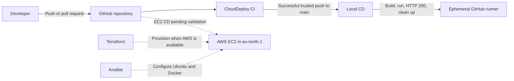

# CloudDeploy

CloudDeploy is an educational Master DevOps project that packages a static HTML/CSS website with Nginx and Docker, validates it with GitHub Actions, and defines a future AWS EC2 deployment path with Terraform and Ansible.

The project demonstrates how to:

- build and test a repeatable container image;
- separate continuous integration from deployment;
- provision infrastructure as code and configure servers idempotently;
- apply least privilege, trusted-event checks, and secure SSH practices; and
- distinguish an ephemeral delivery demonstration from a persistent production deployment.

## Architecture



Solid lines represent the tested GitHub CI and Local CD path. Dashed lines represent the prepared AWS path, which has not been deployed because AWS account verification is pending.

## Technology stack

| Technology | Role |
| --- | --- |
| HTML and CSS | Static CloudDeploy presentation website. |
| Nginx | Lightweight web server inside the container. |
| Docker | Reproducible application packaging and local/runtime testing. |
| GitHub Actions | CI validation, ephemeral Local CD, and the prepared EC2 deployment workflow. |
| Terraform | Defines EC2, security-group, network placement, and outputs in `eu-north-1` (Stockholm). |
| Ansible | Idempotently installs Docker and utilities and configures the Ubuntu host. |
| AWS EC2 | Intended persistent runtime; provisioning and deployment are currently pending. |

## CI/CD pipelines

### Continuous integration

`CloudDeploy CI` runs for pushes and pull requests targeting `main`. It checks the website files, builds the Docker image, starts a test container on runner-local port `8080`, requires an HTTP `200` response, and always removes the container.

### Ephemeral Local CD

`CloudDeploy Local CD` starts only after a successful CI run created by a trusted push to `main`. It checks out the exact commit SHA that passed CI, builds and runs that revision, verifies HTTP `200`, displays container logs, and cleans up. The runner and container are temporary, so this demonstrates automated delivery rather than hosting a persistent environment.

### AWS EC2 CD

The `CloudDeploy CD` workflow contains host-key-verified SSH transfer, a candidate-container health check, deployment verification, and rollback logic. Its automatic trigger is temporarily disabled; only manual dispatch from `main` remains. The workflow has not been tested against EC2 because the AWS account, instance, and GitHub deployment secrets are not yet available.

## Run locally

Prerequisites: Git, Docker Desktop (or Docker Engine), and `curl`.

```bash
git clone <repository-url>
cd devops-clouddeploy
docker build --tag clouddeploy:local .
docker run --detach --name clouddeploy-local --publish 127.0.0.1:8080:80 clouddeploy:local
curl --fail http://127.0.0.1:8080/
docker logs clouddeploy-local
docker rm --force clouddeploy-local
```

Open `http://127.0.0.1:8080` while the container is running. Always remove the test container when finished.

## Terraform

Terraform defines one Ubuntu 24.04 EC2 instance in the default VPC, a restricted security group, and public connection outputs. The default region is `eu-north-1` (Europe/Stockholm).

Run formatting and configuration validation from the repository root:

```bash
terraform fmt -recursive
terraform -chdir=terraform init -backend=false
terraform -chdir=terraform validate
```

When the AWS account is ready, copy the example variables and provide an existing regional key-pair name plus your trusted public IPv4 `/32` CIDR:

```bash
cp terraform/terraform.tfvars.example terraform/terraform.tfvars
terraform -chdir=terraform plan
```

AWS credentials must come from a standard external credential mechanism, never from committed Terraform files. Review the plan before any future `terraform apply`. See [terraform/README.md](terraform/README.md) for details.

## Ansible

Syntax-check the playbook locally without connecting to a server:

```bash
ansible-playbook --syntax-check \
  --inventory ansible/inventory.ini.example \
  ansible/playbook.yml
```

After Terraform eventually creates EC2, copy the example inventory, replace its documentation-only IP address with the `public_ip` output, and run the playbook with a private key stored outside the repository:

```bash
cp ansible/inventory.ini.example ansible/inventory.ini
cd ansible
ansible-playbook --inventory inventory.ini --private-key /secure/path/key.pem playbook.yml
```

Ansible keeps SSH host-key checking enabled and prepares the server; it does not deploy the website. See [ansible/README.md](ansible/README.md) for the full procedure.

## Security practices and limitations

- GitHub workflows use minimal `contents: read` permissions and do not hardcode credentials.
- Local CD accepts only successful `push`-origin CI runs on `main` and checks out the verified SHA with persisted checkout credentials disabled.
- Terraform rejects unrestricted `0.0.0.0/0` SSH access; use a trusted `/32` CIDR.
- Ansible keeps host-key checking enabled, and private keys remain outside source control.
- EC2 CD requires a pinned `known_hosts` entry and GitHub environment secrets before use.
- Terraform state is currently local. Team use would require a secured remote backend with encryption, locking, access control, and versioning.
- The planned website endpoint uses HTTP rather than TLS, and the single-instance design does not provide high availability or zero-downtime infrastructure replacement.
- The Local CD container disappears with its GitHub-hosted runner and is not a production hosting solution.

## Validation status

| Component | Status | Evidence or limitation |
| --- | --- | --- |
| Website and Docker image | Tested | Built locally and served successfully through Nginx with HTTP `200`. |
| GitHub Actions CI | Tested | Successful website validation, image build, HTTP check, and cleanup. |
| GitHub Actions Local CD | Tested | Successful automatic run for a trusted `main` push; exact-SHA deployment, HTTP check, logs, and cleanup. |
| Workflow definitions | Tested | Validated locally with `actionlint`. |
| Terraform configuration | Locally validated | `terraform fmt -recursive` and `terraform validate` passed; no AWS resources were created. |
| Ansible configuration | Locally validated | Playbook syntax validation passed; it has not configured an EC2 host. |
| AWS infrastructure | Pending | AWS verification is pending; Terraform has not been applied. |
| EC2 application deployment | Pending | No instance or deployment secrets exist, so SSH deployment, health checks, and rollback remain untested on AWS. |

## AWS cost and cleanup

EC2 compute, EBS storage, and public IPv4 addresses can incur charges even for a small learning environment or an account with free-plan benefits. Before provisioning, review the current AWS pricing and the Terraform plan for `eu-north-1`. After a future demonstration, preserve any required evidence, then remove resources with the same Terraform state:

```bash
terraform -chdir=terraform plan -destroy
terraform -chdir=terraform destroy
```

Confirm the target account and region before destruction, then verify in AWS that no chargeable resources remain. Do not delete the Terraform state before cleanup is complete.

## Five-minute presentation walkthrough

1. **0:00–0:45 — Goal:** Introduce the website and the progression from source code to automated delivery and future cloud hosting.
2. **0:45–1:30 — Container:** Show the Dockerfile, build the image, and open the Nginx-served site on port `8080`.
3. **1:30–2:30 — CI/CD:** Walk through CI checks, then show how Local CD consumes only a successful trusted `main` result and deploys the exact SHA ephemerally.
4. **2:30–3:30 — Infrastructure:** Explain how Terraform creates the EC2 boundary and how Ansible idempotently prepares the operating system.
5. **3:30–4:20 — Security:** Highlight least-privilege permissions, CIDR-restricted SSH, host-key verification, external secrets, health checks, cleanup, and rollback.
6. **4:20–5:00 — Status:** Show the validation table, clearly state that AWS deployment is pending, and close with cost control and the planned EC2 validation steps.
